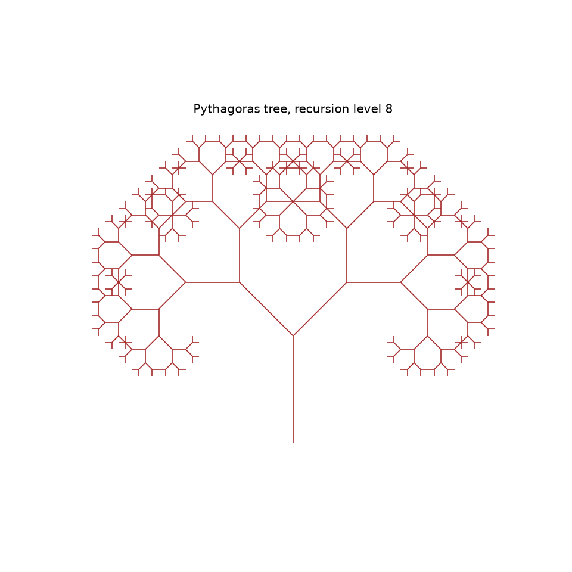
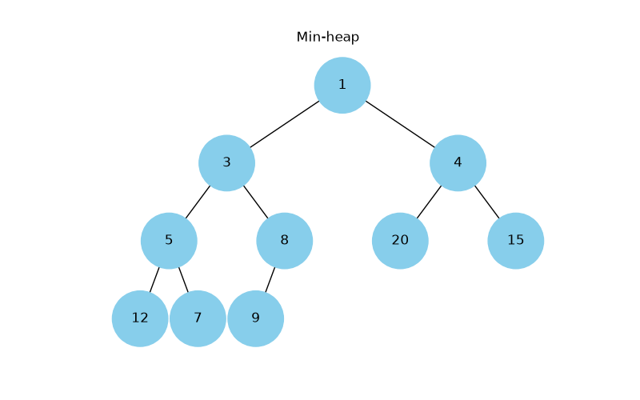
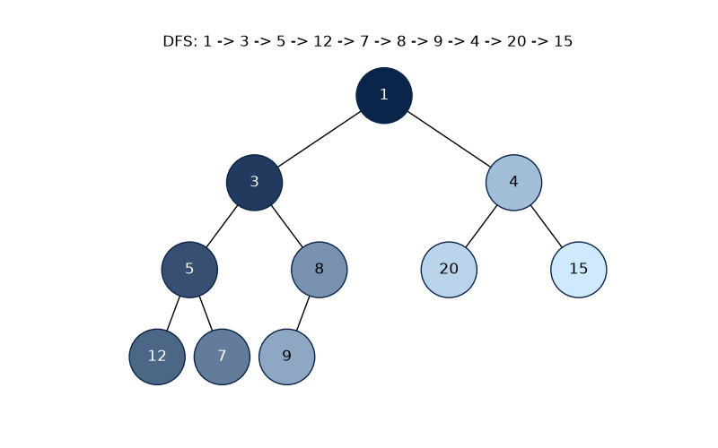
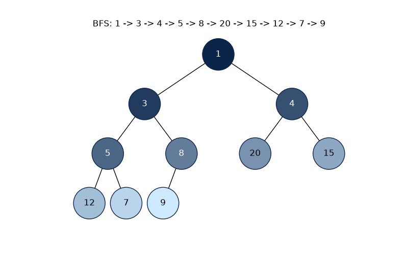
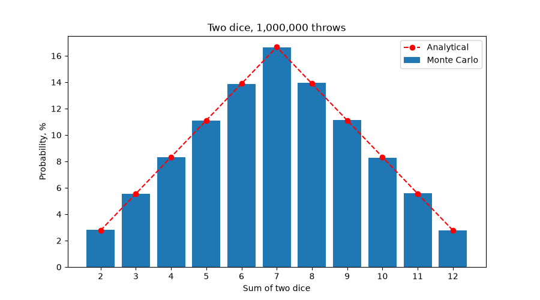

# goit-algo-fp

Final project of the Basic Algorithms and Data Structures course: a linked list, a recursive fractal, Dijkstra's algorithm, heap and tree traversal visualization, greedy and dynamic programming solutions and a Monte Carlo simulation.

## Setup

Python 3.10 or newer. Tasks 1, 3 and 6 use only the standard library. Tasks 2, 4, 5 and 7 need Matplotlib, and tasks 4 and 5 also need NetworkX.

```bash
python3 -m venv .venv
source .venv/bin/activate
pip install -r requirements.txt
```

## Tasks

| Task | File                 | Description                                                                   |
| ---- | -------------------- | ----------------------------------------------------------------------------- |
| 1    | `task_01/task_01.py` | Reverse, merge sort and merge two sorted singly linked lists                  |
| 2    | `task_02/task_02.py` | Draw the Pythagoras tree with recursion                                       |
| 3    | `task_03/task_03.py` | Find the shortest paths with Dijkstra's algorithm and a binary heap           |
| 4    | `task_04/task_04.py` | Visualize a binary heap as a tree                                             |
| 5    | `task_05/task_05.py` | Visualize DFS and BFS tree traversal with colors                              |
| 6    | `task_06/task_06.py` | Choose food within a budget with `greedy_algorithm` and `dynamic_programming` |
| 7    | `task_07/task_07.py` | Find the probabilities of two dice sums with the Monte Carlo method           |

## Run

Run these commands from the repository root. The scripts with plots open a window and save the picture next to the script.

```bash
python3 task_01/task_01.py
python3 task_02/task_02.py --level 8
python3 task_03/task_03.py
python3 task_04/task_04.py
python3 task_05/task_05.py
python3 task_06/task_06.py
python3 task_07/task_07.py
```

### Task 1

`reverse` goes through the list once and turns every `next` link back. `merge_sort` cuts the list in the middle with slow and fast pointers, sorts both halves and joins them with `merge_nodes`. `merge_sorted` joins two sorted lists into a new one. All functions move the existing nodes and do not copy values. The script also checks an empty list and a list with one node.

### Task 2

The level can be passed with `--level`. Without it the script asks for the level and uses 8 when the answer is empty. The level must be from 0 to 15. Every branch gets two new branches turned by 45 degrees and shorter by sqrt(2) / 2.



### Task 3

The graph is a dictionary of roads between Ukrainian cities with distances in km. `dijkstra` keeps the vertices in a heap with `heapq` and always takes the closest one. It returns the distances and the previous vertex for every city, so `get_path` can restore the path. Kyiv to Vinnytsia is shorter through Zhytomyr (270 km) than by the direct road (290 km). Uzhhorod has no roads in this graph, so it is unreachable.

### Task 4

`heap_to_tree` builds a tree from the heap array. The children of index i have indexes `2 * i + 1` and `2 * i + 2`. The script shows a min-heap from `heapq.heapify` and a max-heap.



### Task 5

The tree is built from a min-heap as in task 4. `dfs` uses a stack and `bfs` uses a queue (`deque`), without recursion. The nodes get colors one by one in traversal order, from dark `#0B244A` to light `#CFEAFF`, and every step is shown in the window. The last picture is saved.

| DFS                     | BFS                     |
| ----------------------- | ----------------------- |
|  |  |

### Task 6

Each dish can be taken only once. `greedy_algorithm` sorts the dishes by calories to cost ratio and takes every dish that still fits the budget. `dynamic_programming` solves the 0/1 knapsack problem with a table of the best calories for every budget and then restores the dishes from it. Both functions return the dish names. A negative budget raises `ValueError`.

| Budget | Greedy                                 | Dynamic programming                  |
| -----: | -------------------------------------- | ------------------------------------ |
|     30 | cola, pepsi: 320 kcal                  | potato: 350 kcal                     |
|     50 | cola, potato, pepsi: 670 kcal          | pepsi, cola, potato: 670 kcal        |
|    100 | cola, potato, pepsi, hot-dog: 870 kcal | pizza, pepsi, cola, potato: 970 kcal |

The greedy algorithm is fast but can leave money unused. With the budget 100 it spends only 80. Dynamic programming always finds the best set.

### Task 7

The script throws two dice 1 000 000 times with a fixed seed, counts each sum from 2 to 12 and divides the counts by the number of throws.

| Sum | Monte Carlo |    Analytical | Difference |
| --: | ----------: | ------------: | ---------: |
|   2 |       2.81% |  2.78% (1/36) |     +0.03% |
|   3 |       5.53% |  5.56% (2/36) |     -0.02% |
|   4 |       8.32% |  8.33% (3/36) |     -0.02% |
|   5 |      11.10% | 11.11% (4/36) |     -0.01% |
|   6 |      13.88% | 13.89% (5/36) |     -0.01% |
|   7 |      16.63% | 16.67% (6/36) |     -0.04% |
|   8 |      13.93% | 13.89% (5/36) |     +0.04% |
|   9 |      11.15% | 11.11% (4/36) |     +0.04% |
|  10 |       8.29% |  8.33% (3/36) |     -0.04% |
|  11 |       5.59% |  5.56% (2/36) |     +0.03% |
|  12 |       2.77% |  2.78% (1/36) |     -0.01% |



The largest difference from the analytical values for different numbers of throws:

|    Throws | Max difference |
| --------: | -------------: |
|       100 |          7.33% |
|     1 000 |          1.49% |
|    10 000 |          0.37% |
|   100 000 |          0.21% |
| 1 000 000 |          0.04% |

Conclusion: the Monte Carlo results match the analytical table. With 1 000 000 throws every probability differs by less than 0.05 percentage points. The distribution has the same shape: 7 is the most likely sum and 2 and 12 are the least likely ones. With a small number of throws the error is large, and it goes down as the number of throws grows.
